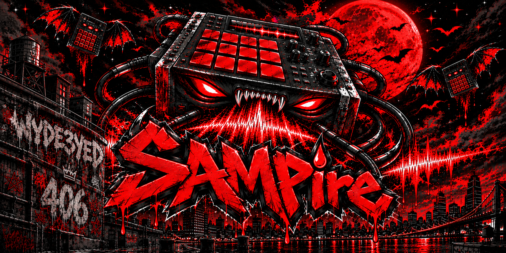

---

A btop-style terminal **sampler, chopper and drum machine** with an autonomous creative engine. Feed it a loop, a
record, a field recording or a live input. It finds the hits, chops them, labels them, transforms some of them,
assigns them to pads, writes patterns, plays them, and records the result. Then you take over with the pads.

Inspired by the Roland SP-404 and Akai MPC workflow. Built in the spirit of [DanEQ](https://github.com/fourzerosix/DanEQ).

```
 SAMPIRE 0.1.0   PLAY  92.0 BPM  swing 12%  pat G2 1.4.4  bank A  src demo-break      silent  2% vox 3 xr 0
 PADS A                              pad 1 kick1  one_shot  stutter(ms=60.0,repeats=6)
 +-------++-------++-------++-------+ (braille waveform with slice markers and playhead)
 |1 kick1||2 kick2||3 kick3||4 kick4|
 |kick   ||kick   ||kick   ||kick   |  STEPS G2 2 bars  steps 1-16/32
 ...                                    1 kick1 # . . . : . . . : . # # : . # .
                                        6 snare : . . . # . . . : . . . # . . .
```

## Quick start

```bash
git clone https://github.com/fourzerosix/SAMPire && cd SAMPire
scripts/install.sh            # Linux or macOS: private venv, `sampire` on your PATH
sampire --selftest            # 16 headless accuracy checks
sampire --demo                # built-in synthetic drum break, no files needed
sampire loop.wav              # chop your own audio
```

Or with pip: `pip install -e ".[audio,midi]"` (needs PortAudio and libsndfile; see `docs/DESIGN.md`).
No audio device? It runs silent (`--no-output`): UI, sequencer, analysis, recording and exports all still work.

## What it does

- **Analyse** on import: tempo, beats, key, onsets, loudness, percussive ratio.
- **Slice** by transient, grid, equal parts, silence or hybrid, with zero-crossing snap.
- **Choose and label** a varied set of chops (kick, snare, hat, tom, bass, tone) and lay them out like a drum kit.
- **Transform** autonomously and nondestructively: reverse, pitch, stretch, stutter, crush, drive, filter, gate,
  tape stop, granular, shuffle and more. Every edit is a recipe you can inspect and undo.
- **Play** 4 banks x 16 pads: one-shot, gate, loop, toggle; velocity, pan, ADSR, choke groups, 32 voices, delay and reverb sends.
- **Sequence** with 960 PPQ, swing, humanize, probability, ratchets, parameter locks, euclidean fills, live recording, song chains.
- **Generate** whole patterns, variations and chop-flips; or just say it: `:prompt chop into 12 pieces, reverse a few, two 4-bar patterns at 95 bpm with swing`.
- **Capture**: record the master output, a rolling 60 s skip-back, threshold sampling from an input, resample the bus into a new pad.
- **Export**: bounce, stems per pad, pad wavs, slices, MIDI file. All deterministic for a given seed.

## Keys (full list in `docs/KEYS_AND_COMMANDS.md`)

| | |
|---|---|
| `1234 qwer asdf zxcv` | play pads (shift = softer hit) |
| `Space` | play / stop |
| `Tab` | switch between pads and the step grid (`Enter` toggles a step) |
| `+` `-` / `[` `]` | tempo / swing |
| `<` `>` / `,` `.` | bank / pattern |
| `^G` `^P` `^V` `^F` | generate kit / pattern / variation / chop-flip |
| `^T` `^B` `^Y` | record output / skip-back to pad / resample |
| `^U` `^R` `^W` `^O` | undo / redo / save / open |
| `:` | command line (`:help`) |
| `?` | key help |

## Headless pipeline

```bash
sampire --analyze loop.wav
sampire --chop loop.wav --mode hybrid --out slices/
sampire --render loop.wav --seed 7 --bars 4 --style break --out beat.wav --stems --save-project MyBeat
sampire --demo --render - --prompt "chop into 12 pieces, reverse a few, two 4-bar patterns at 95 bpm" --out beat.wav
```

Same seed and input give the same audio, bit for bit.

## Install options

- `scripts/install.sh` (Linux and macOS; installs PortAudio/libsndfile through your package manager)
- `pip install sampire[audio,midi]`
- Docker: `docker build -t sampire . && docker run -it --rm sampire` (silent demo) - see the Dockerfile header for audio passthrough

## Documentation

`docs/DESIGN.md` (overview of everything), `docs/ARCHITECTURE.md`, `docs/CREATIVE_ENGINE.md`, `docs/PROJECT_FORMAT.md`,
`docs/KEYS_AND_COMMANDS.md`, `docs/ROADMAP.md`.

## Status

v0.1.0: the engine, analysis, creative engine, sequencer, exports and terminal UI are implemented and covered by
`sampire --selftest` and `pytest`. Real-time audio output, input sampling and MIDI use PortAudio and python-rtmidi
and have not yet been verified on physical hardware; run `sampire --list-devices` first. See "Risks" in `docs/DESIGN.md`.

## License

GPL-3.0-only. Sampling copyrighted recordings for release carries legal obligations that are yours.
